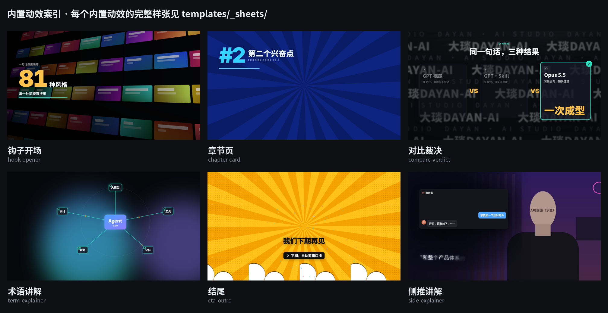

# 大琰DAYAN Motion Studio · AI 口播自动剪辑技能

把一条口播原片交给 AI 助手，说一句"帮我剪辑好"，它会把口误剪掉，配字幕、音效、转场和 MG 动画，交出 60 帧成片和一份能继续改的工程（剪映 / Premiere / 达芬奇）。

这是一个 **Agent Skill**：放进 Claude Code、Codex、WorkBuddy / CodeBuddy 等能读写文件、能运行命令的 AI 助手里使用。动画是代码实时生成的（HTML 时间轴引擎逐帧渲染），不是视频模型生成的。



## 它能做什么

- **画面跟着口播的字走**：字级时间码 + `cue` 对齐。说到数字，数字跳出来；讲以前和现在，画面做前后对比；讲步骤，就一步一步演示；讲一个工具，人物让到一侧，另一侧出演示区。
- **人物是一个连续对象**：全屏、侧边人物卡、圆窗、小方窗、软件窗口、侧推讲解之间平滑迁移，按人脸自动裁切。横屏 16:9、4:3 和竖屏 9:16 都能出。
- **45 个组件 + 动效库 + 内置动效**：大字、印章、划掉改写、数字滚动、对比、流程、清单、对话框、提示词输入、文档标注、软件窗口、任务进度、叠卡讲解……全部是时间的纯函数，可以任意拖动预览。
- **动效不够就现做**：剪辑时没有贴切的动效，助手会按标准现做一个新的，三种画幅检查通过后存进 `effects/` 动效库，下次直接复用。目前已沉淀 76 个，按 12 类组织（开场·标识 / 数据·报表 / 对比·论证 / 流程·关系 / 引用·社媒 / 人物·字幕 / 收尾·CTA / 转场 / 界面演示 / 背景 / 浮窗·画中画 / 质感·调色层，每类至少 5 个，清单见 `references/components.md`）。早期的 16 个：前后对比滑块、剪辑工程时间线、三连按钮、开源仓库卡、评论区挑选、电影感地平线片头、播放键小精灵（原创角色，会跑、跳、翻跟斗、点按钮、放技能）、口播原片、字卡听写 / 口误剪除、分镜翻牌、音效台、导演检查扫描、三画幅落地、交付文件发牌、流水线传送带、全景收束。
- **转场**：推移、甩镜、白闪、斜擦、中线拉开、圆角框放大、百叶窗、文字镂空、元素承接（morph）、翻书……
- **声音**：动作自带接触点音效（CC0 真实采样），可选按分镜能量曲线原创配乐，侧链闪避混音到 −15 LUFS。默认只有人声 + 音效。
- **两道检查**：`direct` 导演检查（大字照抄字幕、一段讲两件事、画面静止、口播里的数字画面上没有、元素出现错位、字幕读不过来），`sweep` 渲染前逐帧试跑查报错。
- **交付**：成片、无字幕画面、SRT / ASS 字幕、人声 / 音效 / 配乐分轨、Premiere / 达芬奇 XML（带每段标记点）、剪映导入说明、HTML 动画工程，可选透明动效层（ProRes 4444 / VP9）。
- **品牌是你自己的**：第一次做作品时会问你的文字墙品牌（主行 + 副行），之后一直沿用；技能里不写死任何人的品牌。

## 安装

需要 Python 3.10+、Node.js 18+、FFmpeg，以及本机的 Chrome 或 Edge（渲染用）。

```bash
git clone https://github.com/jyan5334-lab/dayan-motion-studio.git
cd dayan-motion-studio
python -m pip install -r requirements.txt
npm install
python scripts/dms.py doctor      # 检查环境，缺什么会告诉你
```

Windows 可以用 `winget install Gyan.FFmpeg` 和 `winget install OpenJS.NodeJS.LTS` 装 FFmpeg 和 Node。语音识别模型（约 230MB）第一次使用时自动下载。详细说明见 [references/platforms.md](references/platforms.md)。

把整个文件夹放进你的助手的技能目录：

| 助手 | 放在哪里 |
|---|---|
| Claude Code | `~/.claude/skills/dayan-motion-studio/` |
| Codex | `~/.codex/skills/dayan-motion-studio/`（Windows：`C:\Users\<你>\.codex\skills\`） |
| WorkBuddy / CodeBuddy | 对应的 skills 目录，或在对话里说"读取 <路径>/SKILL.md" |

## 怎么用

在助手里说：

> 用 dayan-motion-studio 剪辑这条口播：D:\视频\口播.mp4，口播稿在 D:\视频\稿子.txt

第一次做新作品时，助手会先问四个问题：画幅（横屏 16:9 / 4:3 / 竖屏 9:16）、分辨率、帧率、文字墙品牌。之后按下面的流程自动完成，最后把成片和工程交给你：

```
转写 asr → 剪口误 cut → 字幕对齐 subs → 分镜草稿 scaffold → 编排 edit.json
→ 检查 lint / build / direct / stills / sweep → 声音 audio → 渲染 render → 导出 export
```

也可以手动跑命令：

```bash
python scripts/dms.py asr 原片.mp4 work
python scripts/dms.py cut 原片.mp4 cut.json work
python scripts/dms.py subs work lines.txt
python scripts/dms.py scaffold work edit.json --canvas 1920x1080 --fps 60
python scripts/dms.py build edit.json proj
python scripts/dms.py direct proj
python scripts/dms.py sweep proj
python scripts/dms.py audio proj
python scripts/dms.py render proj 成片.mp4 --workers 2
python scripts/dms.py export proj
```

只想单独做一段片头、章节页或对比页：`python scripts/dms.py template list`，再 `template render`。

## 目录

```
SKILL.md          技能说明（助手读这个）
references/       剪辑语法 playbook、组件、字段、质量标准、声音、安装说明
engine/           HTML 时间轴引擎（组件、转场、人物窗、字幕）
effects/          动效库：剪辑时现做并沉淀的新动效
templates/        内置动效（片头、章节、对比、术语、侧推讲解、结尾三连）
scripts/          dms.py 命令入口、渲染器、声音、导出
assets/           CC0 音效、人脸模型、大琰DAYAN 动效库原卡
examples/         样片的 edit.json / cut.json / lines.txt
```

## 许可

代码、模板、文档和动效库按 [MIT](LICENSE) 发布，可以自由使用、修改、商用，保留署名即可。随附的音效（CC0）、人脸模型（MIT）、字体（OFL）保留各自原许可，见 [THIRD_PARTY.md](THIRD_PARTY.md)。

更新记录见 [CHANGELOG.md](CHANGELOG.md)。

作者：大琰DAYAN
